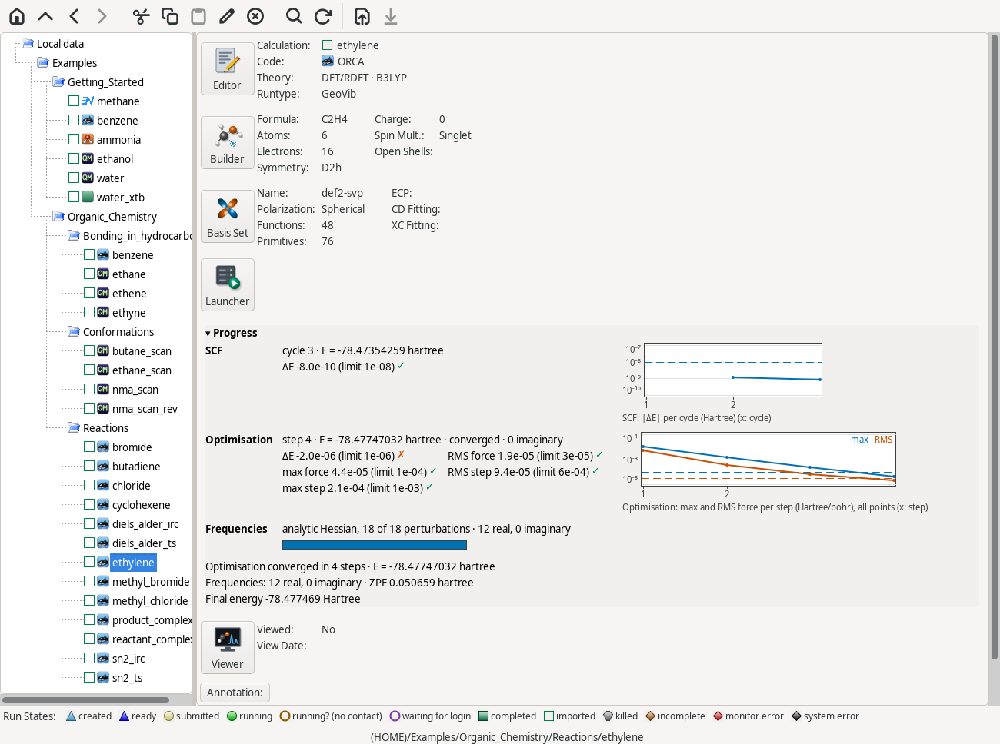
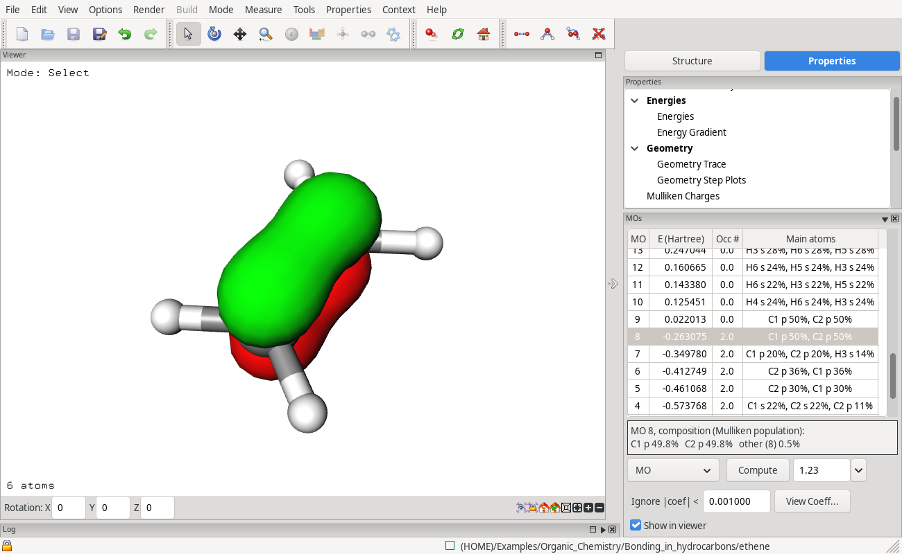
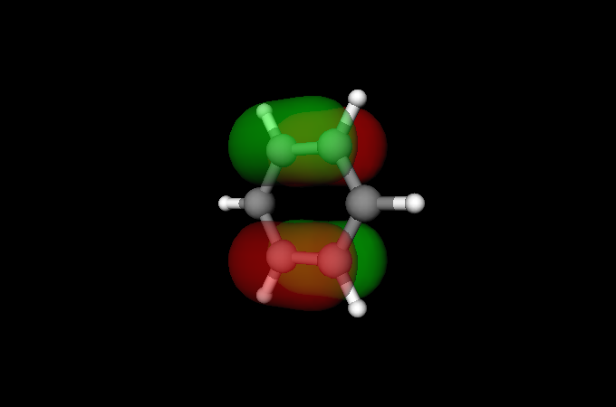
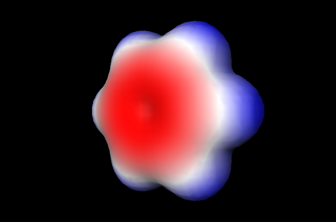
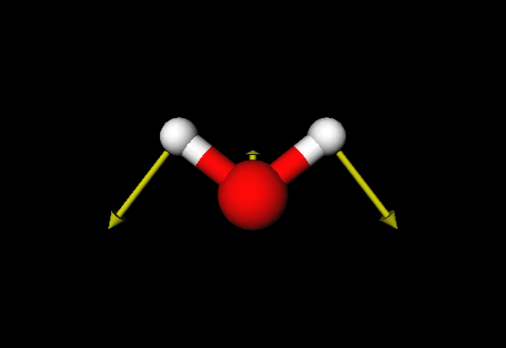
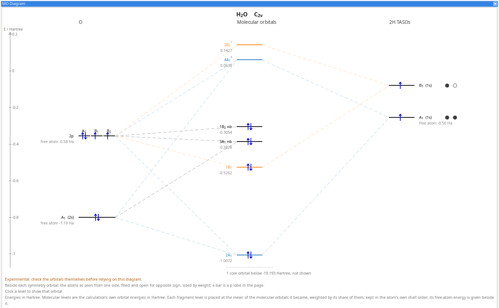

# ECCE overview

ECCE, the Extensible Computational Chemistry Environment, is a graphical
environment for computational chemistry. A molecule or a periodic system is
built or imported, a calculation is set up for one of several codes, the job
is submitted to a workstation or a cluster and followed while it runs, and
the results are read back and shown: energies, structures, orbitals,
densities, spectra and trajectories. Every calculation is kept, with its
input, output and parsed properties, in projects in the Organizer.

## How ECCE is organised

The **client** (`ecce-client`) is the windows you work in, plus a job agent
that submits and follows jobs. Normally it works with an **ECCE server**
(`ecce-server`: a data server and a message broker) that stores projects
and results. The client can instead run **on its own**, keeping its data
in a folder on your disk (Edit → Preferences → Data folder; off by default
on Linux, the default on macOS and Windows); it still starts a private
broker, which needs the `mosquitto` package, but no ECCE server. Neither
server nor client runs calculations, except ECCE-QM on the client's own
computer: they run on a **compute machine**, a workstation or an HPC
cluster, where the client submits each job over ssh.

There are three deployment modes:

* **Local**: client and server on one computer, for one user; each user
  has a private broker reachable only by their own processes.
* **Central server**: one data server and broker for a group, lab or
  class; students or colleagues connect to it from their own computers
  as clients (`ecce -remote`).
* **Shared broker**: several users run ECCE on one shared machine (an
  application server) and use one system broker service.

[Getting started](../GETTING_STARTED.md) describes how each mode is set up.

## General features

* **Build molecular models and periodic systems**, or import a structure
  and work from that.
* **Set up calculations through one interface** for these codes; each
  is built, submitted, monitored and parsed back:
  * **ECCE-QM**, a Hartree–Fock and density functional program built into
    ECCE, for small molecules; it runs on the computer you work at and
    needs nothing else installed;
  * **ORCA**, **Gaussian 16**, **NWChem** and **MOPAC**;
  * **GROMACS**, **CP2K** and **Quantum ESPRESSO** (experimental).
* **Check the input before it goes out**: Verify inspects the generated
  input file before it is submitted, and the Calculation Editor lists in
  a notes panel what the chosen code will and will not use.
* **Choose basis sets graphically**, with the code's own built-in sets
  used where they match.
* **Submit to workstations, clusters and supercomputers**, through Slurm,
  PBS, SGE, LSF, Moab and HTCondor, or by running directly on the machine
  without a batch system.
* **Follow a job while it runs**: energies, geometry steps, convergence and
  the current stage of the run appear in the Progress box and the Viewer
  before the job ends.
* **Visualise results in 3-D**: molecular orbitals, electron and spin
  density, electrostatic potential, vibrational modes with animation,
  dipole moments, optimisation, scan and IRC paths, and MD trajectories.
* **Analyse orbitals** with the MO diagram (experimental), the Density Map
  and the Density Profile.
* **Import output from jobs run outside ECCE**, for centres where ECCE
  cannot submit directly.
* **Teach with ready-made example sets** for general chemistry, organic
  chemistry and spectroscopy, each calculation with a note on what it
  shows.
* **Run one server for a group**, with students or colleagues connecting
  to it as clients.

## Platforms

* **Linux**: client and server packages for Debian 13 (tested), and for
  Ubuntu 24.04, RHEL/Rocky 9 and Fedora (built on those systems, not
  tested).
* **Windows 10 and 11**: client, as an installer or zip.
* **macOS 11 or newer**, Apple silicon and Intel: client, experimental.

## Capabilities

### Building

* Builder with element and atom-shape choice, Clean (geometry clean-up)
  and Add Hydrogens; bonds carry no order, the atom shape sets the
  geometry.
* Measure toolbar: distances, angles and torsions, with units.
* Structure Library: amino acids, DNA and RNA bases, ligands,
  polyoxometalates, simple structures, and a Teaching folder of small
  molecules at their measured bond lengths.
* Peptide and DNA builders.
* Point groups: find, symmetrise, generate symmetry-equivalent atoms.
* Organometallic complexes: σ ligands and π ligands (cyclopentadienyl,
  benzene) bonded to a metal.
* Dummy atoms as reference points.
* Geometry constraints: fixed bonds, angles and torsions; relaxed-scan
  definitions (Scan...).
* Periodic systems: cell from lattice parameters, atoms generated from a
  space group (listed with number and crystal system), Miller-index planes.
* Layer Builder: stacks of one layer with a spacing, a sideways shift, and
  ions and water between the layers (graphite, layered oxides, clays).
* Structure import: XYZ, PDB, CAR and MVM; multi-frame XYZ and `.trj`
  trajectories.

### Codes and methods

| | ECCE-QM | ORCA | Gaussian 16 | NWChem | MOPAC |
|---|:-:|:-:|:-:|:-:|:-:|
| Hartree–Fock, DFT | ✓ | ✓ | ✓ | ✓ | – |
| MP2 | – | ✓ | ✓ | ✓ | – |
| Coupled cluster | – | ✓ | ✓ | ✓ | – |
| CI, QCISD | – | – | ✓ | – | – |
| Semi-empirical | – | – | ✓ | – | ✓ |
| Energy, gradient | ✓ | ✓ | ✓ | ✓ | ✓ |
| Geometry optimisation | ✓ | ✓ | ✓ | ✓ | ✓ |
| Frequencies, IR | ✓ | ✓ | ✓ | ✓ | ✓ |
| Raman activities | ✓ | ✓ | ✓ | – | – |
| TS search from one structure | ✓ | ✓ | ✓ | ✓ | – |
| TS from two structures (NEB-TS, QST2/QST3) | – | ✓ | ✓ | – | – |
| IRC | ✓ | ✓ | ✓ | – | – |
| Relaxed scan | ✓ | ✓ | ✓ | – | – |
| Initial Hessian choice | – | ✓ | ✓ | – | – |
| Implicit solvent | ✓ | ✓ | ✓ | ✓ | – |
| Dispersion correction | – | ✓ | ✓ | ✓ | – |
| TD-DFT excited states, UV-vis | – | ✓ | ✓ | – | – |
| NMR shielding | – | ✓ | ✓ | ✓ | – |
| NBO analysis | – | ✓ | ✓ | – | – |
| Start from a previous calculation's orbitals | ✓ | ✓ | ✓ | ✓ | – |
| Import of an output run elsewhere | ✓ | ✓ | ✓ | ✓ | ✓ |

Per code:

* **ECCE-QM**: RHF, UHF, ROHF; SVWN, PBE, B3LYP, PBE0 (restricted,
  unrestricted, restricted open shell); STO-3G, Pople, Dunning and
  Karlsruhe basis sets; analytic Hessian for closed-shell HF; Opt-TS by
  eigenvector following; CPCM solvent (water, methanol, ethanol,
  acetonitrile, DMSO, chloroform, toluene, hexane or a custom dielectric);
  improved virtual orbitals (HF); Pipek–Mezey localised orbitals; Mulliken,
  Löwdin, CHELPG and Merz–Kollman charges; Raman activities with the static
  polarisability.
* **ORCA**: HF, DFT, MP2, CCSD, CCSD(T) and their DLPNO forms; RIJCOSX;
  D3BJ, D3(0) and D4 dispersion; CPCM and SMD solvent; TD-DFT (number of
  states, singlets/triplets, Tamm–Dancoff); NEB-TS and OptTS; NMR
  (Magnetic run type); CHELPG, Hirshfeld and NBO charges.
* **Gaussian 16**: HF, DFT, MP2–MP5, CIS, CISD, QCISD, CCD, CCSD, CCSD(T)
  and semi-empirical methods (AM1, PM3, PM6, PM7, MNDO, MINDO/3, CNDO,
  INDO); PCM, CPCM, IPCM, SCIPCM and SMD solvent; Grimme D2, D3, D3(BJ)
  and Petersson–Frisch dispersion; TD-DFT; QST2/QST3; CalcFC, CalcAll,
  ReadFC and RecalcFC; NMR, polarisability and absorbance run types;
  Merz–Kollman, CHelpG, Hirshfeld, CM5 and NBO (6 or 7) charges.
* **NWChem**: HF, DFT, MP2, CCSD and CCSD(T); COSMO solvent; Grimme D1–D3(BJ)
  dispersion; ESP-fitted charges; NMR shielding (GIAO), hyperfine and
  indirect spin–spin coupling; plane-wave PSPW and BAND, and
  Car–Parrinello dynamics; NWChem MD (Prepare, Energy, Optimize, Dynamics,
  Solvate).
* **MOPAC**: AM1, MNDO, PM3, PM6, PM7 and RM1, restricted or unrestricted;
  energy, gradient, optimisation and frequencies.
* **Quantum ESPRESSO** (experimental): plane waves and pseudopotentials;
  energy, geometry optimisation and dynamics; cut-off, k-points, smearing
  and dispersion correction; the cluster's pseudopotential folder is used
  when the job runs.
* **CP2K** (experimental): Quickstep (GPW); energy and geometry
  optimisation; dispersion and smearing.
* **GROMACS** (experimental): an MD study of Prepare, Energy, Optimize,
  Equilibrate and Dynamics tasks; Prepare from a PDB file (`pdb2gmx`), a
  mineral or clay (MINFF or ClayFF, bundled) or the Builder's structure;
  NVE, NVT and NPT; defines, position restraints, groups, barostat type and
  extra `.mdp` lines; pull runs; `grompp` messages mapped to the editor's
  fields; import of a finished run as a study.

### Calculation setup

* Calculation Editor per code: Theory, Theory Details, Run Type, Runtype
  Details, charge, spin multiplicity, basis set.
* Basis Set Tool: basis sets and effective core potentials from ECCE's
  library, per element.
* Memory entered in GB for every code.
* Notes panel above the log: what is unused by the chosen code
  (constraints, scans, symmetry), transition-state warnings, why a
  calculation is not ready.
* Verify: the generated input checked before submission.
* Warnings before launch with Launch anyway as the default.
* Duplicate, Duplicate with Final Orbitals, Reset to Rerun.
* Symmetry switched off for transition-state searches, IRC, constraints and
  scans, with a note.

### Job submission and monitoring

* Compute machines registered under Tools > Register Machines: codes,
  modules, run directory and account per user; codes on the PATH registered
  at first start.
* Run on this computer, or on another machine over ssh.
* Queue managers: Slurm, PBS, SGE, LSF, Moab, HTCondor.
* One ssh login per compute machine per session (Linux and macOS).
* Launch Selected: several calculations with their stored launch settings.
* Machine Browser: machine and queue status, allocation (Slurm `sshare` or
  a per-machine command).
* Progress box: SCF and optimisation plots with force convergence, the
  current stage of the run (including frequency and NEB stages), MD
  averages.
* Job states recorded with the calculation, including the reason for a
  failed submit; Terminate Calculation, View Run Log, tail of the output
  file, shell in the run directory.

### Analysis and visualisation

* Energies, energy components, run statistics, point group, ⟨S²⟩.
* Geometry Trace and Geometry Step Plots of an optimisation; playback with
  delay and loop.
* Relaxed Scan and IRC Path panels: graph or table, a structure per point,
  New calculation from this point, CSV export.
* Molecular orbitals as surfaces, orbital energies and occupations; the
  MOs panel lists localised orbitals where computed.
* MO diagram (experimental): orbitals as levels joined to fragment
  orbitals, chosen by picking an atom or a bond; a ligand-field view.
* Density Map: density or one orbital as contours on a plane through the
  molecule.
* Density Profile: density, ψ² or ψ along a line or radially around an
  atom, with each orbital's share; orbitals of an atom named 1s, 2s, 2p…
* Total density, electrostatic potential on the density surface, spin
  density with Mulliken spin populations.
* Charges: Mulliken, Löwdin, Hirshfeld, CM5, CHELPG/ESP-fitted,
  Merz–Kollman, natural (NPA), APT, MBIS, AIM (Bader), as each code
  provides them.
* Dipole moment as an arrow from the negative to the positive pole;
  polarisability as an ellipsoid; quadrupole and higher moments.
* NMR: isotropic and anisotropic shielding, shielding tensors, spin–spin
  coupling, Fermi contact.
* Vibrations: frequencies with symmetry and description, animation and
  displacement vectors, IR and Raman spectra, frequency scale factor,
  spectra compared side by side, mode composition by internal
  coordinates, CSV export.
* UV-vis spectrum from TD-DFT, transitions listed with their orbital
  weights.
* Reaction Energies panel for a transition state built from two
  calculations.
* Compare Energies (Organizer): the difference of two final energies in
  Hartree, kJ/mol, kcal/mol and eV, with notes on differing code, method
  or basis set.
* MD: MD Summary (final values, averages with standard deviations),
  trajectory playback in the true box (including dodecahedral and
  truncated-octahedral cells), every logged series against time with a
  moving average, speed distribution against Maxwell–Boltzmann, mean-square
  displacement with the diffusion coefficient, pull force.
* Copy values from any value list, export plots, maps and spectra.

### Data management

* Organizer: projects and calculations in a tree, run-state icons, a
  Calculation Summary, buttons for the editor, Builder, Basis Set Tool,
  Launcher and Viewer.
* Data on an ECCE server (local or central) or in a local data folder.
* Import Calculation from Output File: ECCE-QM, ORCA, Gaussian 16, NWChem,
  MOPAC.
* Import GROMACS Run.
* Manage Files, View Input/Output File, reviewed/unreviewed marks.

### Teaching

File > Open Example Calculations imports example sets, already read in,
sorted by topic, each calculation with a note:

* **Getting Started**: small calculations with ECCE-QM, MOPAC, NWChem and
  ORCA, imported at first start.
* **General Chemistry**: atoms; ionisation energies and electron
  affinities; Koopmans' theorem; molecular orbitals of diatomics; polar
  bonds and dipole moments; VSEPR; Lewis structures and resonance; gases,
  liquids and solids by molecular dynamics.
* **Organic Chemistry**: bonding in hydrocarbons; conformations (relaxed
  torsion scans); reactions (SN2, Diels–Alder: transition states and IRC).
* **Spectroscopy**: sulfate coordination, carbonyl compounds, amides and
  peptides, sugars, small molecules: IR, Raman and orbitals.
* **Computational**: a GROMACS study of the Trp-cage mini-protein, from
  Prepare to Dynamics.

Opening a set again adds what is missing without changing existing
calculations.

## Screenshots

Click any image for the full-size version.

*The Organizer: projects and calculations on the left, each with a
run-state icon, and a summary of the selected one in the middle, with
buttons for its editor, builder, basis set tool, launcher and viewer —
here a completed ORCA calculation on benzene.*

*The viewer: a calculation's orbitals and energies beside the structure
they were computed for — benzene, from ORCA.*

| | | |
|---|---|---|
|  |  |  |
| Benzene's π HOMO (ORCA) | Electrostatic potential on the surface (ORCA) | A vibrational mode of water, as displacement vectors (Gaussian 16) |

*A qualitative MO correlation diagram — water's orbitals, from Gaussian
16, against the oxygen on one side and the hydrogens' symmetry orbitals
on the other, with the non-bonding lone pair picked out. The same
diagram is drawn from any of the supported codes. Experimental.*
