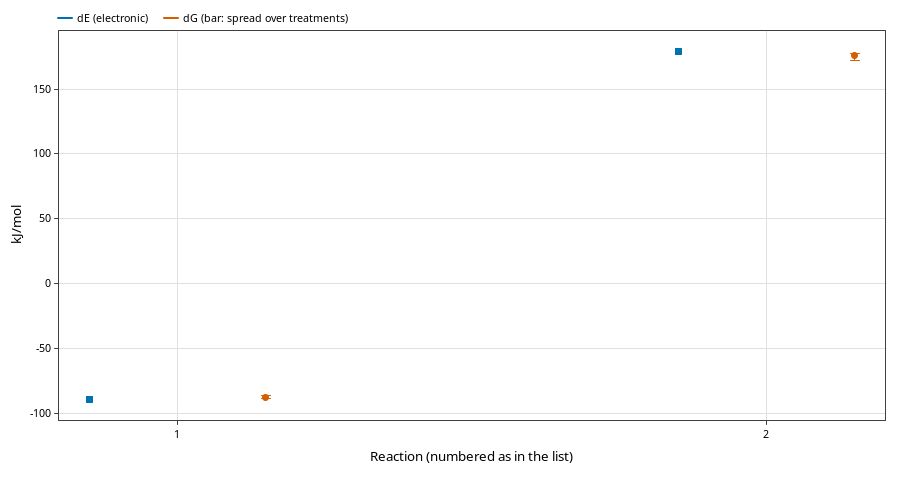

**ECCE 9.5.0.** Please report problems as [issues](https://github.com/FriendsofECCE/ECCE/issues).

**Platforms.** Linux (Debian 13; Ubuntu 24.04, RHEL/Rocky 9 and Fedora 44 packages are built on those systems but not tested). Windows 10 and 11. macOS, Apple silicon and Intel: experimental.

## Upgrading from 9.4
- **Organizer menus (#805):** a calculation's right-click menu is Cut, Copy, Paste, Rename, Delete, **New from This** (Rerun, Continue from Last Geometry, Continue from Final Orbitals) and **Run** (Launch, Reconnect, Terminate, Re-Parse Outputs, Shell in Run Directory). The project table has no Viewed or Size column, shows Type and Application in one column and has a Total energy column.
- **Local by default.** A new installation keeps calculations in a folder on this computer and asks nothing at first start. Installations already set up with a data server start as before (#767).
- **Edit > Preferences > Data** shows the local folder and a list of servers. **Add Server** adds an ECCE server or an SSH folder; each appears in the Organizer as its own tree, with its own login, and calculations in it are launched and stored there (#767, #789).
- Every command-line tool now has a wrapper on PATH (`ecce-<tool>`), including the new `ecce-workflow` and `ecce-density-field` (#794).

## Workflows and recipes
- **Workflows:** File > New > Workflow draws a set of calculations as a tree. Select a box and a code to add a step that starts from that box's final structure, charge and multiplicity; **Launch Ready Steps** launches every step whose source is complete. Joins make QST2/QST3 or NEB-TS steps from a reactant, a product and a TS guess; a step can start from a scan point (#341, #674, #782).
- **Recipes:** Apply Recipe builds the linked boxes of a TS search with IRC, a conformer search, protonation sites, tautomers or a solvation shell, with the method and basis set of each role and one solvent for every step, shown in a live preview. A workflow can be saved as a recipe, and a calculation can be turned into a workflow (#710, #807, #808).
- Each box shows one result line (energy; for an IRC the TS energy); a CREST box shows the stage, the metadynamics count, the structures found and the lowest energy (#810, #784). A link from a CREST ensemble carries the lowest conformer (#812).
- Examples: the SN2 workflow and a Na⁺(H₂O)₆ workflow (xTB arrangements refined with ORCA r2SCAN-3c) in File > Open Example Calculations (#712, #772, #784).

## New codes
- **xTB** (GFN2, GFN1, GFN-FF): energies, optimisations, frequencies and thermochemistry, implicit solvent (ALPB, GBSA), orbitals from xtb's Molden file, molecular dynamics; runs made outside ECCE can be imported (#362).
- **CREST:** conformer search, protonation sites, tautomers and solvation shells, with an ensemble table ranked by energy, with Boltzmann populations and coordination patterns (#682, #708). Select rows in the ensemble table and choose New Calculation from Selected to set up one calculation per structure in the same folder, named <calculation>_conf<rank> (#708). The solvation shell (QCG) needs an xtb newer than the one in Debian 13 (#758, #809).
- **ML potential** (ASE, MACE first): energies and geometries, with cell relaxation, for screening (#728).

## Analysis of many calculations
- **Compare Energies:** select calculations in the project table, or a folder, and right-click **Compare Energies...**: ΔE/ΔG from the lowest or a chosen reference, per cell, formula unit or site, with consistency flags; a progress window above three calculations (#703, #805). **Tools > Energy Calculator...** is the former Compare Energies window, for the energy of sums of calculations such as a reaction.
- **Reaction overview** (button in the Compare Energies window): ΔE/ΔG chart for a set of reactions with the spread over low-frequency treatments (#709).

- **Command line only** (no menu items): Checks table for a folder (state, convergence, imaginary modes, ⟨S²⟩, E, ZPE, G), export for Supporting Information, Compare Forces, the excluded mark with a reason, and core hours booked and used; see Scripting and AI assistants in the help (#615, #625, #776, #617, #627, #805).
- **New Series:** one setup applied to a list of structures, with `ecce-series` (command line only) (#621, #805).
- **Thermochemistry:** G with a chosen low-frequency treatment (RRHO or quasi-RRHO), with the spread (#692). One imaginary-mode rule everywhere: a mode below 1 cm⁻¹ counts as zero (#792).
- **Vibrations:** matched bands and shifts between two calculations, a difference spectrum and an experimental overlay; a new calculation displaced along an imaginary mode (#707, #618).
- **Displacement/RMSD** between two calculations; spin per atom (#701, #616).
- **MD Compare:** up to eight calculations of a folder in one plot (Speed Distribution, MSD) (#678).

## Orbitals and densities
- **Surfaces** category in the Properties panel: Density, Spin Density, ESP on Density, ELF, LOL and NCI, each with a description (#787, #799, #800).
- **MO Diagram for a single atom:** the subshells with their electrons as boxes, or the orbital energies to scale (#813). #817: textbook staircase of subshells (aufbau order) for a single atom.
- Density Map: best-fit and principal planes for non-planar molecules (#659). Density Profile: square-root y axis (#715).
- ECCE-QM: every library basis set and the Basis Set Tool (#765); restricted open-shell atoms converge (#790); IRC branches leave from the relaxed saddle, so they end in different minima (#764).

## Running jobs
- **Command line:** `ecce-launch`, `ecce-terminate`, `ecce-reconnect`, `ecce-fetch`, `ecce-annotate`, `ecce-move`, `ecce-rename` and `ecce-rerun` work inside the running session (`ecce-move`/`ecce-rename`: #824; `ecce-rerun`, a Ready copy of a killed, failed or finished calculation, optionally launched: #825); `AGENTS.md` describes them for scripts and AI assistants (#687, #695, #720, #721, #742, #759).
- **Launcher:** threads per MPI rank (Slurm `--cpus-per-task`, `OMP_NUM_THREADS`, CP2K `psmp`); memory per node (#739).
- **SSH:** after a dropped connection ECCE reconnects with the password it already has; optional Remember on this computer (#777).
- **Progress box:** energies in Eh with six decimals, a summary line for each finished stage (SCF converged in N cycles, optimisation, frequencies), and the final energy says what it contains, e.g. "(SCF + D3)" for ORCA (#826).
- A job whose output stopped growing is flagged Stalled (#769). Reconnect follows one rule in every menu and is greyed out for Completed and Killed calculations (#689).
- MD tasks copy back `traj.xtc`, `ener.edr` and `topol.tpr`, and time continues along a study chain (#743).
- CP2K: a basis and a potential file per element row; mixing, Broyden history and Added MOs; the HOMO–LUMO gap stored; `*.pdos` copied back; an out-of-memory kill quotes CP2K's HFX estimate (#697, #698, #720, #739).
- Gaussian 16 IRC settings in Runtype Details (#688); ORCA IRC TS orbitals (#751).

## Builder
- Stretch or shrink the bonds of one atom; combine structures from two calculations; Select Within Distance (#619, #620, #662).

## Fixes
- Compare Energies and the Checks table no longer freeze the Organizer, and no longer load every MO table (#793). `ecce-reconnect` and `ecce-fetch` with a path outside the data no longer crash the Organizer (#814). No crash when the code is switched on the code bar (#785) or when `ecce-launch` runs before anything is loaded (#781). A stored table with the wrong number of values warns once (`ecce-check-props` finds them) (#719, #722).
- Scans with atoms far apart: a scan or trace step that puts atoms outside the view re-fits the camera (#832). A hidden MO Diagram is no longer rebuilt at every scan or IRC step (#838). The no-access panel names a moved calculation's new folder (#823). Organizer menus review fixes: Total energy after a rerun, reference chooser, numeric sort (#819).
- All fixes released in 9.4.1 to 9.4.10, among them outputs no longer stored empty when the login to the compute host fails at the end of a job (#732), and orbital names with the principal quantum number with Show core orbitals in the MO Diagram (#827).

## Known issues
- **Windows:** uninstalling takes long (#815); a few items are off at 150-200 % display scaling (#670); the first start takes about a minute on slower computers (#444).
- **GROMACS, CP2K, Quantum ESPRESSO** and the **ML potential** are experimental. **The MO diagram** is experimental.
