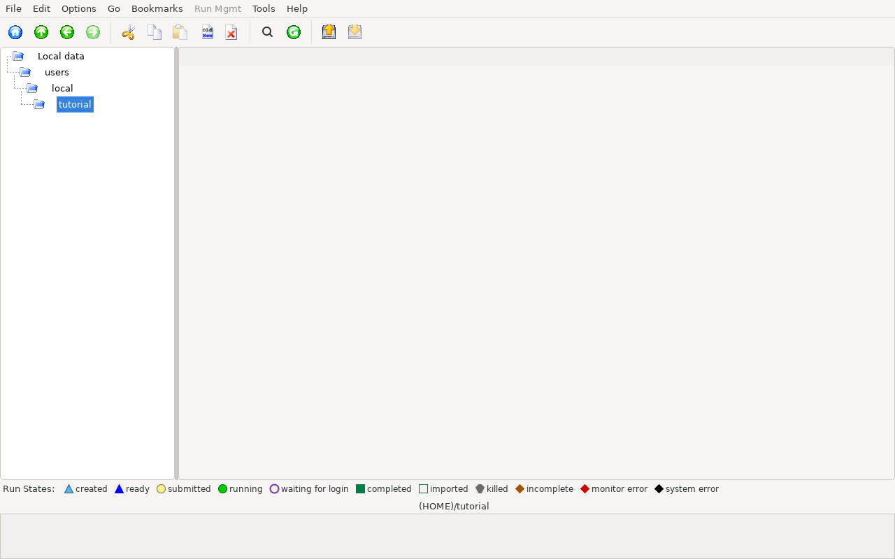
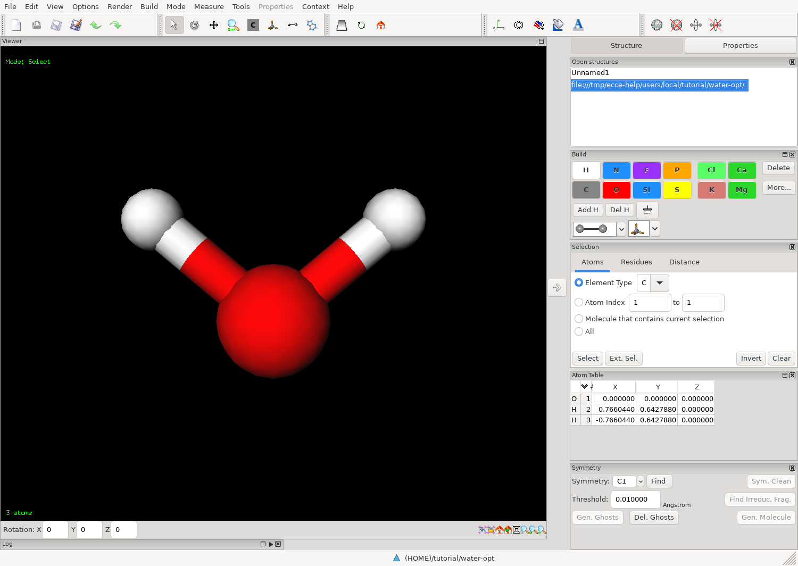
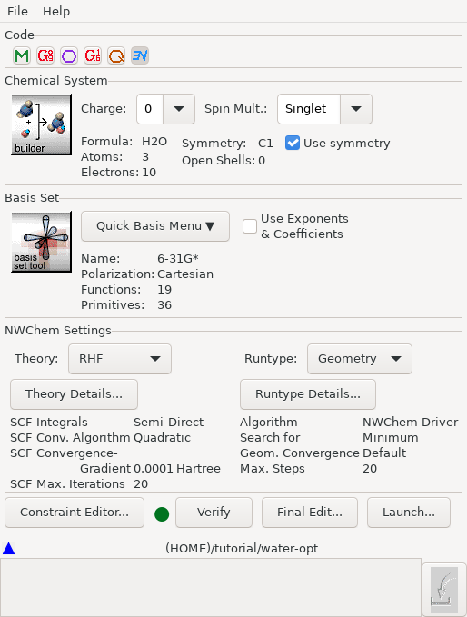
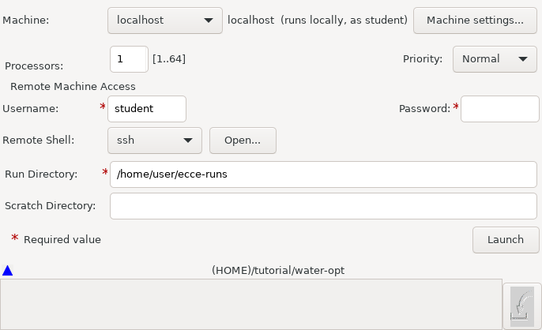
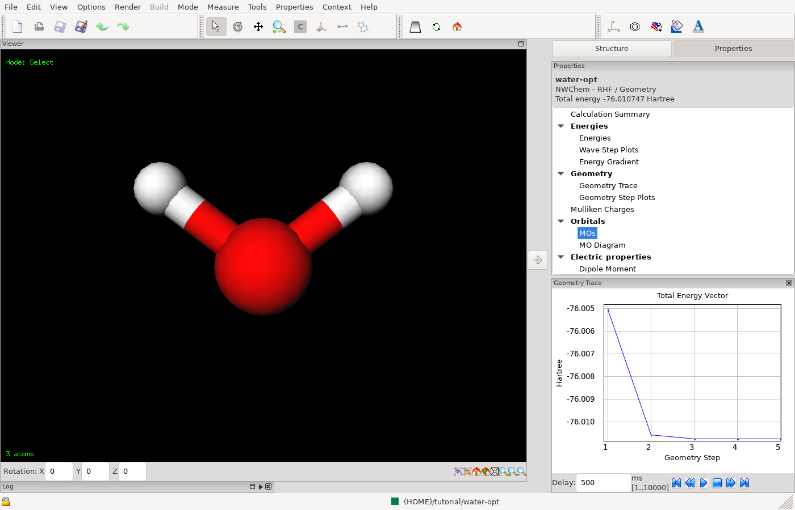

# Your first calculation

In this tutorial you optimise the geometry of a water molecule with NWChem
at the Hartree-Fock level, then look at the energy, the optimisation steps
and, optionally, the vibrational frequencies.

You need:

- ECCE installed and started with `ecce` (see [Installation](installation.md)).
- NWChem installed, so that the command `nwchem` works in a terminal. The
  machine `localhost` runs it for you (see [Machines](machines.md)).

The calculation takes seconds.

## 1. Create a project

A project is a folder that holds calculations. Every calculation belongs to
a project.

1. In the Organizer, select your home folder in the tree on the left.
2. Choose **File > New > Project...**.
   You can also right-click the folder and choose **New... > Project...**.
3. In the window "New Project Name", enter `tutorial`.
4. Click **OK**.

The project appears in the tree. Names may contain letters, digits, `.`,
`_` and `-`.

<!-- capture: Organizer with the project "tutorial" selected in the tree -->

## 2. Create a calculation

1. Select the project `tutorial`.
2. Choose **File > New > NWChem Calculation...**.
   You can also right-click the project and choose **New... > NWChem
   Calculation...**.
3. In the window "New Calculation Name", enter `water-opt`.
4. Click **OK**.

The calculation appears under the project, with the run state **Created**.
It has no molecule yet.

By default ECCE does not open an editor for the new calculation. (The
Organizer menu **Options** has the entry **Invoke Default Tool at
Creation** if you prefer that.)

## 3. Build the molecule

1. Select `water-opt`.
2. Click **Builder** below the calculation's details in the Organizer.

The Builder opens on this calculation. (If you have not used the Builder
before, [Importing a structure](importing-a-structure.md) shows how to open existing
structure files in it.) To add water from the structure
library:

1. In the **Mode Toolbar**, click the button with the tooltip **Import from
   Structure Library**. You can also choose **Mode > Add Structure**
   (Ctrl+7).
2. In the **Structure Library** panel, choose `SimpleStructures` in the
   **Libraries** drop-down, then open the folder `Miscellaneous2` by
   double-clicking it. The button next to the drop-down goes up one
   level.
3. Click `h2o` in the list. A preview appears in the panel.
4. Click in the empty 3D view. The molecule is added there.

If you prefer to draw the molecule yourself:

1. An empty structure opens ready to place carbon, the element shown on
   the round chip in the Mode Toolbar. Otherwise choose **Mode > Atom**
   (Ctrl+5), or click that chip.
2. Choose the element O: click **Element selector**, the small periodic
   table beside the chip, and pick O in the table that opens below it.
3. Click in the empty 3D view to place the oxygen atom.
4. Choose **Build > Add Hydrogen** (Ctrl+F) to complete the valence with
   hydrogen atoms.
5. Choose **Build > Clean** (Ctrl+K) to tidy the geometry.

The default shape of oxygen is Bent, with two open bonds, and **Add
Hydrogen** fills each open bond with a hydrogen atom.

To join two atoms yourself, click the **Bond** button in the Mode Toolbar
(two grey balls joined by a stick; tooltip **Draw bonds**), or choose
**Mode > Bond** (Ctrl+6). Click the first atom, then the second. The kind of
bond (Covalent or Metal-π) is chosen in the Build panel, not on the button.
The button stays pressed while Bond mode is active; press **Esc** or click
another mode button to leave it.

Then save the structure:

1. Choose **File > Save** (Ctrl+S).
2. Close the Builder with **File > Quit** (Ctrl+Q). If it asks "Save Builder
   Changes?", save.

<!-- capture: Builder window, water in ball-and-stick, Structure Library panel closed -->

## 4. Set up the calculation

1. Select `water-opt` in the Organizer.
2. Click **Editor**.

The editor shows what you built under **Chemical System**: **Formula:**
`H2O`, **Atoms:** 3, **Electrons:** 10. **Charge:** is 0 and **Spin
Mult.:** is Singlet, which is correct for water.

Set the rest:

1. Under **Code**, check that the button shows NWChem.
2. In the **NWChem Settings** box, choose `RHF` in **Theory:**.
   `RHF` is restricted Hartree-Fock for a closed-shell molecule.
3. In **Runtype:**, choose `Geometry`. This optimises the geometry.
4. Under **Basis Set**, click **Quick Basis Menu**, then choose `6-31G*`.
   The fields **Name:**, **Polarization:**, **Functions:** and
   **Primitives:** show the chosen basis set.
5. Click **Verify**. This checks the input for obvious problems before you
   submit it.
6. Choose **File > Save** (Ctrl+S).

The buttons **Theory Details...** and **Runtype Details...** open further
options for the chosen theory and run type. The defaults are right for
this calculation.

To see the input file ECCE will send to NWChem, click **Final Edit...**.
The button is enabled when the setup is complete (the run state is
**Ready**). It opens the input file in your text editor: the editor set in
**Edit > Preferences**, otherwise the one named by the `VISUAL` or `EDITOR`
variable. If you close the editor without saving, nothing changes. If you
save a change, ECCE uses your edited file, and later changes in the
Electronic Structure Editor ask before they replace it.

<!-- capture: Electronic Structure Editor with NWChem, RHF, Geometry, 6-31G* set for water -->

## 5. Launch

1. In the editor, click **Launch...**.
   Or select the calculation in the Organizer and choose **Tools >
   Launcher...** (Ctrl+L).
2. In the Launcher, choose `localhost` in **Machine:**.
3. **Run Directory:** starts as `ecce-runs` in your home folder (for example
   `/home/<you>/ecce-runs`) when no directory is saved for this machine.
   Change it if you want the job to run elsewhere. The path must start
   with `/` or `~`. ECCE creates the folder, with its parents, if it does
   not exist.
4. Click **Launch**.

The Launcher shows progress messages and, at the end, "Successfully
submitted job."

For `localhost` the Launcher shows **Processors:**, **Priority:** and **Run
Directory:**. There are no login, password or remote shell fields: the job
runs as you, on this computer. **Scratch Directory:**, **Username:** and
**Machine settings...** are under **Advanced**, which is closed until you
click it. **Queue:**, **Nodes:**, **Alloc. Account:**, **Wall Time Limit:**,
**Scratch Space:** and **Memory Limit:** belong to machines that run jobs
through a batch queue, and appear for those machines. A machine reached
over the network shows the **Remote Machine Access** fields (**Username:**,
**Password:**, **Remote Shell:**).

<!-- capture: Launcher with Machine: localhost, Run Directory filled, before Launch -->

## 6. Watch the run

Return to the Organizer. The icon of `water-opt` shows its run state.
**Options > Show Run State Legend** (on by default) lists the states and
their icons.

The states you see, in order, are **Submitted**, **Running** and
**Complete**. A calculation that ended with an error is **Failed** or
**Unsuccessful**. An ORCA optimisation that stopped at its cycle limit, and a
CP2K run whose SCF or optimisation did not converge, are **Unsuccessful**
too: the code ended normally, but its energy or structure is not a result.
The summary gives the reason; the outputs are kept. You can also select the
calculation and read its summary in the panel next to the tree.

While a job is **Submitted**, waiting in a batch queue, the summary has a
**Progress** box that says since when it has been queued and, if the
machine gave one, the job id. It does not show the queue's own state for the
job; to see that, choose **Check Job on Machine** from the **Run Mgmt**
menu. If ECCE loses contact with the job's monitor, the box turns grey and
says when the job was last heard from.

To read the files while the job runs, select the calculation and use the
**Run Mgmt** menu:

- **Tail -f on Output File...** follows the output as it grows, in a
  window of its own over the login ECCE already has for the machine, so
  it does not ask for the password again. **Pause** holds the view while
  new lines keep arriving; **Resume** shows them.
- **View Output File...** and **View Input file...** open the files.
- **View Run Log...** shows ECCE's log of the job.

If the state is **Failed**, open **View Output File...** and read the end
of the file. The most common causes are a wrong path to the code (see
[Machines](machines.md)) and an input error that **Verify** would have
reported. On a machine with a queue system (Slurm, PBS, SGE) the code's
own error can be in the queue's error file instead, such as `slurm.err`.
ECCE brings that file back into the calculation's Outputs when it has
text in it, and the reason shown for a failed calculation names it.

## 7. Look at the results

1. Select `water-opt`.
2. Click **Viewer**.

The Viewer shows the final geometry. (The same Viewer shows the output of a
calculation run elsewhere: see [Importing a calculation](importing-a-calculation.md).) Open the results from its
**Properties** menu. Each entry shows or hides a panel. A panel whose plot
or table needs more room can be dragged out by its title bar into a window
of its own; **Tools > Dock Floating Panels** puts them back. See
[Arranging the Viewer's panels](viewer-panels.md).

- **Calculation Summary** lists the theory, run type and basis set, and
  when and where the job ran.
- **Energies** lists the energies of the calculation, including **Total
  Energy**. For an NWChem RHF geometry run the rows are **Nuclear
  Repulsion Energy**, **One-Electron Energy**, **Total Energy** and
  **Two-Electron Energy**, each in Hartree.
- **Geometry Trace** plots one quantity against the geometry step, one point
  for each step. It opens on the **Energy Gradient Magnitude**. To plot the
  energy, right-click the panel and choose **Total Energy**; the picture
  below shows that plot. The energy is drawn relative to step 1 in kJ/mol,
  and the title gives the final absolute energy in Hartree. Click a point on
  the plot to see the molecule at that step, or use the playback control to
  step through them; **Play** continues from the selected step.
  **Delay:** sets the time between steps during playback (milliseconds); tick
  **Loop** to play forward to the last step and back, until stopped. All plots zoom
  with the mouse wheel (Shift+wheel zooms the vertical axis only) or by dragging a
  rectangle, but never beyond the data;
  Home or a double click on empty plot shows all of it. In the **Wave Step
  Plots** (the SCF cycles), the energy change and the density and orbital
  gradient changes are drawn as log10 of their size.

For a converged optimisation the energy decreases from step to step and
levels off in the last steps, and the gradient falls towards zero.

<!-- capture: Viewer on the finished water-opt calculation, Geometry Trace panel open with the energy plot -->

### Vibrations (optional)

To also compute vibrational frequencies, repeat the tutorial with a second
calculation:

1. In the project, select `water-opt` and choose **Edit > Duplicate for
   Rerun**. Or create a new calculation as in step 2.
2. In the Electronic Structure Editor, choose `GeoVib` in **Runtype:**.
   `GeoVib` optimises the geometry and then computes the frequencies.
   **Duplicate for Rerun** copies the calculation with its structure and
   settings and resets it, ready to launch.
3. Save and launch as before.
4. In the Viewer, choose **Properties > Vibrational Frequencies**.
5. Use the **Table** and **Graph** tabs to see the three frequencies.
6. Choose **Animation** and select a frequency to see the motion.
   **Amplitude:** sets the size of the displacement and **Delay:** the
   speed. **Vector** shows arrows and stops the animation.

A geometry optimisation that has reached a minimum has no imaginary
frequencies.

## Starting from the orbitals of an earlier calculation (ORCA)

An ORCA calculation keeps its final orbitals when it has finished. A
follow-on calculation can start from them instead of from ORCA's own initial
guess, which saves SCF iterations and helps difficult cases converge.

1. Select the finished ORCA calculation and choose **Edit > Duplicate with
   Final Orbitals**. The copy has the last geometry, as with **Duplicate
   Setup with Last Geometry**, and the orbitals belong to that geometry.
   The item is greyed out for other codes and for a calculation that has
   no stored orbitals; its help line says which.
2. Open the copy in the Calculation Editor. Under **Settings** it shows
   **Initial guess: MOs from** the calculation they came from. Change the
   method, the run type or the basis set as you need.
3. If you choose another basis set, the line adds **(projected from** the
   old basis set**)**: ORCA projects the old orbitals onto the new basis.
4. **Use Default Guess** drops the orbitals and returns to ORCA's own
   guess.

The orbitals are a binary file of a few megabytes, copied to the machine
that runs the job.

## Geometry optimisation settings (ORCA)

In **Runtype Details...** of an ORCA **Geometry** or **GeoVib** calculation:

- **Find:** **Minimum** is ORCA's ordinary optimisation. **Transition State**
  writes `! OptTS` and searches for a saddle point. A transition-state search
  needs a good initial Hessian, so set **Initial Hessian** to **Calculate**
  (or to **Read from previous calculation**). With neither, the input
  checker warns; the calculation is not blocked.
- **Initial Hessian:** **Default** keeps ORCA's model Hessian. **Calculate**
  writes `Calc_Hess true`. **Read from previous calculation** writes
  `inhess read` and the name of the Hessian file (`.hess`) of the
  calculation this one was made from with **Edit > Duplicate with Final
  Orbitals**. That file exists only if the earlier job computed a Hessian
  (a frequency job, or an optimisation with **Calculate**). If none is
  attached the checker warns and ORCA uses its default.

## Plane-wave calculations (NWPW)

NWChem's plane-wave module, NWPW, has no code of its own in the list of
codes. Choose it in the **Theory:** list of an NWChem calculation: **PSPW**
or **BAND**. Neither needs a basis set. Car-Parrinello
molecular dynamics is a run type of **PSPW**; choose it in **Runtype:**
after you have chosen **PSPW**.

## Where next

Change the theory to `RDFT`, or the basis set to `cc-pVTZ`, and compare the
total energy. The next chapters describe each window in more detail.
