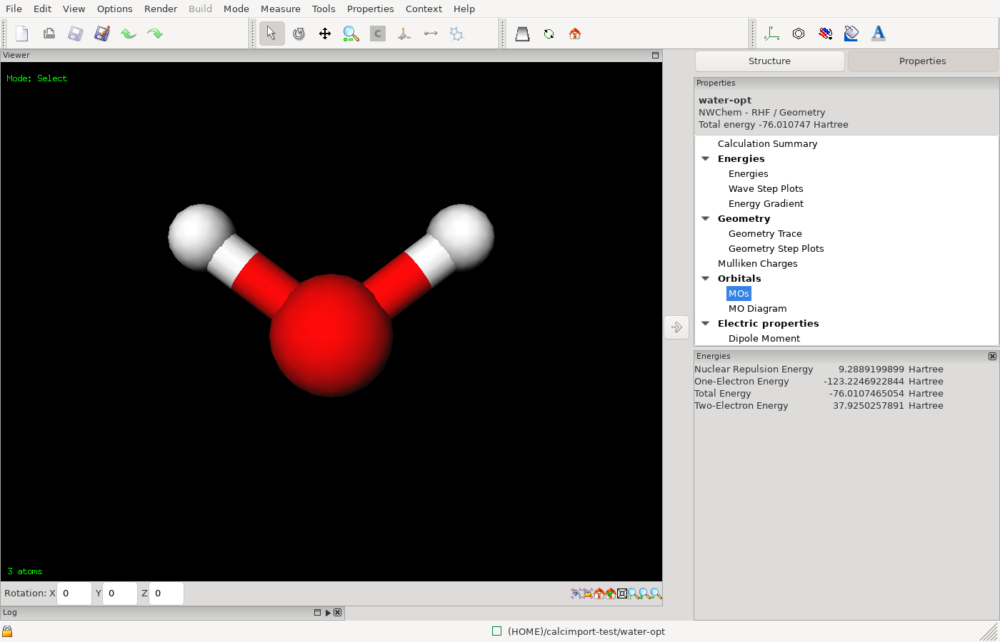

# Importing a calculation

If you have the output file of a calculation that ran elsewhere, ECCE can
read it and show the results as if it had run the job. No compute machine
and no computational chemistry code are needed. To open a structure file
instead, see [Importing a structure](importing-a-structure.md).

You need ECCE started with `ecce` (see [Installation](installation.md)).

## Which outputs can be imported

ECCE recognises the code from a marker line in the output file:

| Code | Output file |
|---|---|
| NWChem | The output of a run (the file contains "Northwest Computational Chemistry Package"), or ECCE's formatted output (`ecce_print`). |
| Gaussian 16, 09, 03, 98 | The output (log) file. The version is read from the line "Gaussian NN, Revision". |
| ORCA | The output of a run (the file contains the "O   R   C   A" banner). |
| ECCE-QM | The output file of the built-in program (`.qmout`). |
| MOPAC | The output of a run (the file contains "MOPAC v"). ECCE reads the Hamiltonian, run type, charge, spin and the last geometry. |
| xTB | The output of an `xtb` run (the file contains the "x T B" banner), with the files xtb wrote beside it: the geometry, and orbitals, charges and modes when the run produced them. See [xTB](xtb.md). |

Output files of other codes are not recognised and the import ends with
"Unrecognized output file format--cannot import." Quantum
ESPRESSO outputs cannot be imported, although ECCE can run that code.
GAMESS-UK, Amica and MOLCAS are not recognised either. Importers for
Gaussian 03 and 98 exist but were not tested in this version.
From an ORCA output ECCE always reads the molecule. It fills in the
theory and run type only when the keyword line of the ORCA input (the line
starting with `!`) uses keywords ECCE knows: HF, RHF, UHF, RKS or UKS, the
functionals B3LYP, PBE0, PBE, BP86, BLYP, TPSS, M06L and M06, and the run
types Opt, Freq, EnGrad and NMR. Other methods, such as MP2 or coupled
cluster, are not decoded. The basis set is recovered only when the input
gives it by library name, not in a `%basis` block.

## Import the file

1. In the Organizer, select the project that should hold the calculation.
   If you select a calculation or something inside a project, ECCE uses
   the project above it. If nothing selected lies inside a project, the
   import ends with "Can't access or write to the specified parent project
   for the import." Create a project first, as in step 1 of
   [Your first calculation](first-calculation.md#1-create-a-project).
2. Choose **File > Import Calculation from Output File...**.
3. In the window "ECCE Import Calculation from Output File", select the
   output file and click **OK**. The window opens in the folder you used
   last, or in your home folder.

ECCE names the new calculation after the job. For NWChem it uses the name in
the `start` (or `restart`) line of the input echoed in the output, and for
Gaussian the job title, with characters other than letters, digits, `.`
and `_` replaced by `_`. Otherwise it uses the name of the file without its extension (importing
`nwchem_water_optfreq.out` gives a calculation named `nwchem_water_optfreq`).
If the project already contains a calculation with that name, ECCE appends
`-1`.

The message line shows "Calculation output currently being imported into
<project>/<calculation>." The calculation appears in the tree, is selected,
and shows the run state "Imported". The Viewer
can be slow to respond until the import has finished.

Importing NWChem output prints "WARNING: Could not parse basis set from
calculation output file (attempting import without it)." This is expected
for NWChem output and the import still succeeds.

Import needs the machine `localhost` to be registered, which it is by
default (see [Machines](machines.md)). It does not run any code. It needs
Perl and the ECCE parser scripts that come with `ecce-client`.

The Builder has the same entry under **File > Import Calculation from
Output File...**. It puts the calculation in your home folder instead of a
project, and opens it in the Builder.

## Import a GROMACS run

A finished GROMACS run in a folder can be imported as a GROMACS MD study.
The folder holds one subfolder for each task, in run order, for example
`1-prepare`, `2-optimize`, `3-equilibrate` and `4-dynamics`. The word
`prepare`, `optimize`, `equilibrate` or `dynamics` in the subfolder name
tells ECCE the kind of task. A study may start at any task.

1. In the Organizer, select the project that should hold the study.
2. Choose **File > Import GROMACS Run...**.
3. In the window "Choose the directory of the GROMACS run", select the
   folder and click **OK**.

The study is named after the folder. The results of each task appear
shortly after the import, as they do for a run that ECCE started.

## Look at the results

1. Select the imported calculation in the Organizer.
2. Click **Viewer**.

The Viewer shows the geometry in the output: the final geometry for an
optimisation. Open results from the **Properties** menu; the menu lists
only what ECCE found in the file.

- **Calculation Summary**: code, theory, run type, basis set and run
  statistics.
- **Energies**: the energies read from the output, including **Total
  Energy**.
- **Geometry Trace**: the energy and geometry at each step of an
  optimisation. Click a point on the plot to see the molecule at that step.
- **Mulliken Charges**: the atomic charges.
- **Dipole Moment**: the dipole.
- **MOs**: the molecular orbitals, described below.
- **MO Diagram**: the orbitals drawn as an energy level diagram. The panel is
  labelled experimental.
- **Vibrational Frequencies**: the frequencies and normal modes, described
  below.

These entries appear when the code and the run type produced them. An
energy-only calculation has no **Geometry Trace**, and a calculation
without a frequency run has no **Vibrational Frequencies**. Which entries
each code supplies is listed in its parse specification
(`scripts/parsers/*.desc`).

<!-- capture: Viewer on an imported calculation, Energies panel open -->

### Orbitals

1. Choose **Properties > MOs**. The panel lists the orbitals in a table, one
   row for each. The columns are **MO**, **E (Hartree)** and **Occ #**,
   and the rows are sorted by energy.
2. In the choice next to **Compute**, choose **MO**, **Density** or **Spin
   Density**.
3. Select an orbital row.
4. Click **Compute**. ECCE calculates the orbital on a grid and draws its
   surface in the 3D view, with different colours for the two signs.
5. Use the toolbar buttons of the panel to change how the surface is drawn
   (for example **Contour**), and **View Coeff...** to read the coefficients
   of the selected orbital.

Orbitals need the molecular orbital coefficients and the basis set in the
output. If the output has no orbitals, **MOs** is missing from the menu.
ECCE reads NWChem orbitals only from its own formatted output, which the
`ecce_print` line in the input ECCE generates produces; a plain NWChem
output file has none. An ORCA output has the coefficients only if the
input asked for them with `Print[P_MOs] 1` in a `%output` block, which
the input ECCE generates does; ORCA's default output lists only the
orbital energies and occupations.

### Vibrations

1. Choose **Properties > Vibrational Frequencies**.
2. Use the **Table** and **Graph** tabs to see the frequencies.
3. Choose **Animation** to see the selected vibration move at once, and
   select another frequency to animate that one. **Amplitude:** sets the
   size of the displacement and **Delay:** the speed. With the pointer
   over the 3-D view, **Space** pauses the animation and resumes it, for
   a measurement or a picture of a displaced structure. **Vector** shows
   arrows instead and stops the animation, as does closing the panel or
   choosing another property; the structure is back as calculated.

The **Table** has a row for each vibration:

- **Frequency**, and the **Infrared** and **Raman** intensities the code
  computed.
- **Sym**: the irreducible representation of the vibration in the
  molecule's point group, found by ECCE from the displacements, so every
  code gets it. A code that prints its own labels (Gaussian, MOPAC) is
  shown with the code's label. Hold the pointer over a cell to see whether
  the vibration is IR active and Raman active, which follows from the
  irrep. `?` means the vibration is not a clean irrep of the group found,
  as happens with a structure that is only nearly symmetric.
- **Mode**: what moves, in the standard notation of vibrational
  spectroscopy. Hold the pointer over a cell for the shares, or select the
  row to read them in the line under the table (also under the plot in the
  Graph view): irrep, description, and which of IR and Raman it is active in.
  The six zero-frequency rows are the translations and rotations of the
  molecule (**Tx** to **Rz**), with their irreps. Where the output prints no
  displacement for them, ECCE names them in the usual order, translations
  then rotations, and the tooltip says so.

| Symbol | Meaning |
|---|---|
| ν̃ | stretch |
| δ | bend |
| ρ | rock (CH2, CH3) |
| ω | wag, out-of-plane motion of CH2 |
| τ | torsion |
| γ | out-of-plane bend |
| s, as | symmetric, antisymmetric: equivalent bonds or angles moving in phase, or not |

Examples are ν̃(C=O), ν̃as(OH), δ(HOH) and ρ(CH2). Two terms, as in
ν̃(C=O) + δ(HCH), mean two comparable contributions; a trailing … means
more. The shares come from projecting the vibration on the bonds, angles and
torsions of the structure, so they say what moves, not how much each
contributes to the energy. The structure's bonds and their orders (C=O,
C≡N) are those of the Builder. A wide **Mode** cell is cut short in a
narrow panel; the tooltip has all of it.

See [Your first calculation](first-calculation.md#vibrations-optional) for
the same steps on a calculation you ran yourself.

## Where the data is kept

Calculations you import are stored in your projects, in the place ECCE keeps your data: the data server, or the local folder if you use local data mode (see [Installation](installation.md)). The Organizer tree shows them. ECCE reads your original output file when you import it and does not change it.

## Next steps

To run a calculation yourself, continue with [Machines](machines.md) and
[Your first calculation](first-calculation.md).
