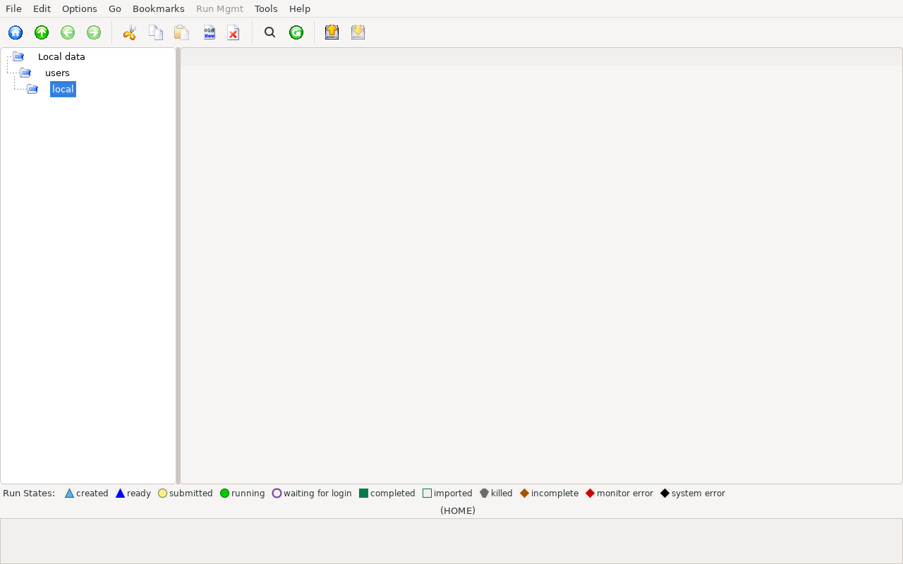

# Installation

ECCE is installed from packages. This page tells you which packages you
need, how to install them, and what you see when you start ECCE for the
first time.

## The two packages

ECCE is split into a client and a server package.

| Package | Contains | Needed when |
|---|---|---|
| `ecce-client` | The windows you use (Organizer, Builder, Launcher, ...), the input generators and output parsers, and the scripts that start your message broker. | Always. |
| `ecce-server` | The data server that stores your projects, the structure and basis-set libraries, and the login check for a shared message broker. | You keep your calculations on a data server on this computer, or you are setting up a server for others. |

Choose one of these:

- **One computer, everything on it.** Install both packages.
- **Your own computer, connecting to a server run by someone else** (for
  example a teaching server). Install only `ecce-client`. Your instructor
  gives you the server address and your login.
- **The server for a group.** Install `ecce-server` on the server computer
  and `ecce-client` on every computer that connects. This is set up by an
  administrator: see *Deployment modes* in `GETTING_STARTED.md` in the ECCE
  source tree.

ECCE does not include a computational chemistry code. To run the example
in this chapter you also need NWChem. Its package is called `nwchem` on Debian, Ubuntu,
Rocky and Fedora.

## Install on Debian or Ubuntu

1. Download the `.deb` files for your system from the ECCE releases page on
   GitHub (`FriendsofECCE/ECCE`). Use the `ubuntu24.04` files on Ubuntu.
2. Open a terminal in the folder with the downloads.
3. Install the packages. For one computer with everything on it:

   ```
   sudo apt install ./ecce-client_<version>_amd64.deb ./ecce-server_<version>_amd64.deb
   ```

   For a client only, name only the `ecce-client` file.
4. Install NWChem:

   ```
   sudo apt install nwchem
   ```

`apt` installs the other packages ECCE needs. Debian's `mosquitto` package
also starts its own system service. ECCE does not use that service and
starts its own broker; you can ignore it.

## Install on Rocky Linux or another RHEL system

1. Enable the EPEL repository, which provides the message broker and the
   3D library:

   ```
   sudo dnf install epel-release
   ```
2. Download the `el9` `.rpm` files from the ECCE releases page.
3. Install them:

   ```
   sudo dnf install ./ecce-client-<version>.el9.x86_64.rpm ./ecce-server-<version>.el9.x86_64.rpm
   ```

   For a client only, name only the `ecce-client` file.

## Install on Fedora

1. Download the `fedora` `.rpm` files from the ECCE releases page.
2. Install them:

   ```
   sudo dnf install ./ecce-client-<version>.fedora.x86_64.rpm ./ecce-server-<version>.fedora.x86_64.rpm
   ```

   For a client only, name only the `ecce-client` file.

The Debian packages are the ones that are tested. The Ubuntu, Rocky and
Fedora packages are built on those systems but have had less testing.

## Install on macOS

The macOS version is experimental.

1. Find out which kind of processor the Mac has: Apple menu > **About This
   Mac**. "Chip: Apple M..." needs the `arm64` file, "Processor: ... Intel"
   the `x86_64` file. An Intel build on an Apple silicon Mac runs only with
   Rosetta; without it, ECCE says which file to install and stops.
2. Download `ECCE-<version>-arm64.dmg` or `ECCE-<version>-x86_64.dmg` from
   the ECCE releases page, open it and drag **ECCE** to **Applications**.
3. ECCE is not notarised by Apple, so at the first start macOS says it cannot
   check the app for malware. Either run, in Terminal,

   ```
   xattr -dr com.apple.quarantine /Applications/ECCE.app
   ```

   or open ECCE once, click **Done**, then choose System Settings > Privacy &
   Security, and click **Open Anyway** next to "ECCE was blocked". On macOS
   14 and earlier, right-click the app and choose **Open** instead.

## Install on Windows

Run `ECCE-windows-<version>.msi` from the ECCE releases page. It installs
for your own user and needs no administrator rights; start ECCE from the
Start menu. Windows shows a SmartScreen warning because the program is not
signed: choose **More info**, then **Run anyway**.

## Start ECCE

Start ECCE from a terminal with:

```
ecce
```

Always start ECCE with `ecce`. Do not start `ecce-builder` or the other
`ecce-<name>` commands directly: `ecce` first starts the services the
windows need. The Organizer opens first. Open the other windows from it.

The `ecce-client` package also adds an **ECCE** entry to the applications
menu. It starts the same `ecce` command.

On a GNOME or other Wayland desktop, ECCE's windows run through XWayland.
There, ECCE uses GTK's own input method for typing, because with IBus the
typed text did not appear until Enter was pressed. To use another input
method, start ECCE with `GTK_IM_MODULE` set to it (ECCE then also keeps
your `XMODIFIERS`).

On a Wayland session, the transparent orbital surfaces can show bands and
stripes. Logging in with "GNOME on Xorg" avoids this.

## What you see the first time

### Where your work is kept

ECCE works on this computer by default and asks nothing at the first
start. Your projects and calculations are kept in a folder on this
computer (`~/.ECCE-local`; on Windows the folder `ecce-local` in your user
folder), and the Organizer opens directly.

To keep calculations on a server as well, choose **Edit > Preferences**, tab
**Data**. The box **Calculations on this computer** shows the folder and has
**Change...** and **Open**. The box **Servers** lists the servers you have
added, with their name, type and address:

- **Add Server...** asks for a type. An **SSH folder (SFTP)** needs a name,
  a host, a port, a user and a folder. The port is 22 unless the site gives
  another one. An **ECCE server (https)** needs a name and
  the address of the server, for example `https://ecce.example.edu`; a port
  other than 443 goes in the address, as in `https://ecce.example.edu:8443`.
  The login is asked when you connect. **Test connection** checks that an ECCE
  server answers and shows whether its certificate is trusted. For an SSH
  folder it logs in, checks that the folder exists and can be written, and
  offers to create it if it is missing. The server needs only an SSH
  account and a folder; nothing is installed or run there. A login and a
  remembered password belong to the host and its port, so two SSH folders
  on one host with different ports are two logins.
- **Edit...** changes the selected server and **Remove** takes it out of the
  list. Nothing on the server is deleted.

The list of servers is stored for you. Each ECCE server in the list is a
tree of its own in the Organizer, below **Local data**, named
**<name> (ECCE server)**. Opening it asks for your login on that server
(the login is kept for that server only, never used for another one). If the
login is cancelled or refused the tree stays marked **(not connected)** and
**Reconnect** in its right-click menu asks again; this never changes where
ECCE keeps your calculations. **Remove** in Preferences takes the tree out of
the Organizer at once. In a server tree you can browse, make projects and
calculations, open, rename, delete and copy within that tree. A calculation in a server
tree is launched like any other (Launch, Launch Selected, the Launcher): the
job runs where you choose, and its output and results are stored on that
server with your login there. Copying or moving between **Local data** and a
server, or between two servers, is not supported yet.

Each SSH folder in the list is a tree too, named **<name> (SSH)**, with the
folder as its top level. Opening it logs in to the machine the way job
submission does (a key, a password or a code, and the shared connection if
your `~/.ssh/config` has one), so it is asked once; if that fails the tree
stays **(not connected)** and **Reconnect** tries again. Browsing, making
projects and calculations, renaming and deleting work as in the other trees,
and a calculation there is launched like any other: the job runs where you
choose and its results are written to the folder over the same login. A
launch is refused with a message if there is no login to the folder.

The trees are told apart by their icon and colour. **Local data** keeps its
home icon. An ECCE server has a server icon in maroon, and an SSH folder has
a folder icon with a terminal mark in green. The rows below a server or SSH
tree have a light tint of the same colour, so you can see where a project is
kept even when the top of the tree has scrolled out of view. A tree marked
**(not connected)** is shown in grey.

A server that your administrator set up for the installation is listed as
**Set by your administrator** and cannot be changed or removed. ECCE does
not ask at the start on a computer whose administrator has already set up a
server, in the account that runs the server, or for a user who connected to a
server in an earlier version. That earlier server stays listed; **Remove** on
it goes back to the folder on this computer from the next start.

If the server proves who it is with a certificate that your computer already
trusts, ECCE connects without further questions. Otherwise ECCE remembers
the certificate the server shows the first time you connect. If that
certificate ever changes, ECCE does not log you in and says so; ask the
server's administrator.

The login window for a server also has a button **Use this computer
instead...**. It switches to the folder on this computer and ECCE goes on
to start on this computer. On Windows, start ECCE again to work on this
computer.

Changes of where ECCE works apply the next time you start ECCE: close all
ECCE windows, then start ECCE again. Your calculations are not copied from
one place to the other. This works the same on Linux, macOS and Windows.

If you did not choose a server, ECCE keeps your projects and calculations in
one of two places on this computer.

### On a data server

ECCE starts a data server for you. Before your first start, create your
account on it:

1. Start the data server:

   ```
   ecce-dataserver-start
   ```
2. Create your account:

   ```
   ecce-dataserver-adduser
   ```

   Answer the prompts for your name, a user name and a password. Use your
   Unix user name as the user name; the login window offers it by default.
3. Start ECCE with `ecce`.
4. In the login window ("Please enter your data server user name and
   password:"), check that **Server:** is the server you expect.
5. Enter your **User name:** and **Password:**.
6. Click **OK**.

If you tick **Save Passwords Between Invocations**, ECCE stores the
password and does not ask again. The title of the login window is
"ECCE Authentication".

If the account does not exist, ECCE shows "There is no account for ... on
this ECCE data server". Create the account with `ecce-dataserver-adduser`
and start again.

If you have forgotten your password and the server is this computer's own,
type your user name in the login window and click **Forgot password...**.
Enter the new password twice and click **OK**; ECCE sets it and logs you in.
On someone else's server there is no such button: ask the server's
administrator to reset the password. On the server they run
`ecce-dataserver-adduser --passwd <user name>`.

If you connect to someone else's server, run `ecce-remote-setup
<server-host>` once, then start with `ecce -remote`. Your administrator
gives you the host name.

### In a folder on your computer (local data mode)

In local data mode there is no data server and no login. Your projects and
calculations are stored in an ordinary folder, by default `~/.ECCE-local`.
This suits one person on one computer.

To use it from the first start:

1. Start ECCE with the folder named in the environment:

   ```
   ECCE_LOCAL_DATA=$HOME/.ECCE-local ecce
   ```
2. The Organizer opens without a login window.

To make it permanent:

1. In the Organizer, choose **Edit > Preferences**.
2. Open the **Data** tab.
3. To use another folder, click **Change...** next to **Folder:** and
   choose it.
4. Close the window and restart ECCE. The setting applies from the next
   start.

Changing mode copies nothing. The calculations of the other mode stay where
they are, and the new mode starts empty. The variable `ECCE_LOCAL_DATA`
overrides the setting in Preferences.

Local mode reads the structure and basis-set libraries from the
`ecce-client` package. It does not need `ecce-server`.



<!-- capture: Organizer window, freshly started in local data mode, nothing selected, Run State Legend visible -->

## Notice of new releases

At most once a day, a few seconds after the Organizer opens, ECCE asks
GitHub which releases exist. If a newer one in your release line is
available, a bar appears at the top of the Organizer: "ECCE 9.0.0-beta.2 is
available." **Release notes** opens the release page in your browser, and
**Don't remind me about this version** hides the bar until a still newer
version is published. ECCE 8.18 hears only about newer 8.18 patch releases.
ECCE 9 hears about newer 9 releases. A preview (alpha or beta) also hears
about newer previews; a final release hears only about final releases unless
you tick **Also tell me about previews**.

The request carries nothing but the name and version of ECCE. Nothing is
downloaded or installed, and if you are offline or GitHub does not answer,
ECCE says nothing. If you installed ECCE from your distribution, update it
with the package manager instead.

To turn the check off, untick **Check for new releases** under **Edit >
Preferences**, tab **General**. Administrators can switch it off for
everyone on an installation by removing the `#` from the
`ECCE_NO_UPDATE_CHECK yes` line in `siteconfig/site_runtime`, or for one
start by setting `ECCE_NO_UPDATE_CHECK=1` in the environment. No request is
then made at all, and the checkbox is greyed out with a note.

## Switches for testing and troubleshooting

**Edit > Preferences**, tab **Advanced**, has check boxes for switches that
developers and the people helping you may ask you to turn on: the C++
Details dialogs, fixed-function lighting in the 3-D view, no progress
records for older calculations, diagnostic output, and log files for the
MO-diagram symmetry analysis and for data-server logins. Leave them off
otherwise.

**OpenGL drawing** at the top of the tab chooses how the 3-D view draws text
and transparent surfaces. **Automatic**, the default, reads the name of the
OpenGL renderer the view runs on: on a software renderer (for example in a
virtual machine, over some remote connections, or on a computer without a
graphics driver) all text in the view is drawn as geometry and transparent
surfaces start in the quick mode; on a graphics card nothing changes.
**Software-safe** and **Hardware** force one of the two. Try Software-safe if
the 3-D view crashes or its text is missing, and Hardware if ECCE takes a
graphics card for a software renderer. The environment variable
`ECCE_GL_PATH=software` or `ECCE_GL_PATH=hardware` does the same and wins
over the setting. The renderer and the path in use are written to the
program's error output when the 3-D view starts, and appear in **Help >
About** and in the diagnostics of **Help > Report a Problem...**.

A change applies to programs started afterwards; a program that is already
open keeps its settings until you restart it. Where a switch is also an
environment variable, a variable you have set yourself wins over the check
box, and the tab says so. This is how to use the switches when you start ECCE
from the Start menu or the Dock, where no variable can be set.

## Reporting a problem

**Help > Report a Problem...** (in every ECCE window) collects what is needed
to find out what went wrong into a folder `ecce-bug-<date>` in your home
folder, and packs it as `ecce-bug-<date>.zip` next to it. On Linux and macOS
this takes about half a minute; it holds the ECCE version, your system, the
logs of the services and the checks that ECCE's diagnostic tool makes. On
Windows it holds the ECCE version, the Windows version, the ECCE logs and the
last ECCE crash records of the Windows event log.

A window then shows where the archive is. **Open folder** shows it in your
file manager, and **Open issue page** opens ECCE's page for a new issue in
your browser. Describe what you did and what happened, and attach the
archive there. ECCE sends nothing itself. The archive holds no passwords, but
it does hold host names, user names and folder paths: look through it before
you attach it.

## Next steps

For administrators and central servers, see `GETTING_STARTED.md`: it covers
accounts for a class, the shared broker, and building from source.

To look at a structure or at existing results first, continue with
[Importing a structure](importing-a-structure.md) or
[Importing a calculation](importing-a-calculation.md). To run calculations, continue with
[Machines](machines.md).
